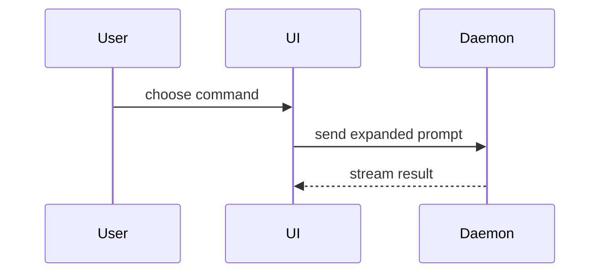

Use this template for writing the PR body. Preserve closing issue references within
Summary and use Conventional Commit titles. Contributor instructions still govern
commands, vocabulary and validation; the template below governs the body structure.

```markdown
## Summary

<diagram, diff-sketch, or tree>

## Evidence

- **Before:** <video/output/failing test run>
  **After:** <video/output/passing test run>

## Merge Danger

**Door:** <one-way or two-way>

<optional: description>

**Blast Radius:** <one-word description>

<optional: potential ramifications of merge>
```

## Sections

Skip all preambles and keep prose brief. Use the user's domain language from the relevant domain context docs and respect applicable system or context ADRs. Read `docs/agents/domain.md` for this repository's context and ADR layout.

### Summary

Pick the smallest view that makes the key point clear.

- Show logic or an algorithm as pseudocode:

```text
on(save)
  if content is unchanged
    return cached result
  write new content
  return fresh result
```

- Show runtime control flow as a call tree:

```text
submitForm
  createSession
    persistPrompt
    launchAgent
  navigateToSession
```

- Show UI structure as a component tree, including state and module boundaries that matter:

```text
<SessionPage> (apps/example/src/routes/session.tsx)
  useSessionEvents()
  <SessionToolbar>
    <RunSkillButton> (packages/ui)
```

- Show file responsibility or a broad refactor as a shallow file tree:

```text
src/
├── commands/       # parses user actions
├── sessions/       # owns session state
└── transport/      # sends API requests
```

- Show component interaction, control flow, or data flow with Mermaid:



- Use `diff` when the point is what changes and the surrounding shape already exists. Match the diff shape to the topic.

For a component change:

```diff
 <SessionPage>
   useSessionEvents()
   <SessionToolbar>
+    <RunSkillButton />
   <SessionTimeline>
+    <SkillResultCard />
```

For a file-layout change:

```diff
 src/
 ├── commands/
+│   └── show-me.ts       # expands the slash command
 ├── sessions/
-└── transport.ts
+└── transport/
+    ├── client.ts
+    └── stream.ts
```

For a call-tree or call-stack change:

```diff
 submitForm
   createSession
     persistPrompt
+    expandSkillMention
     launchAgent
-  navigateToSession
+  navigateToSession
+    subscribeToEvents
```

For a state or control-flow change:

```diff
 on(save)
-  write content
+  if content is unchanged
+    return cached result
+  write new content
+  invalidate cache
```

- Show the whole block when most of it is new, when omitted context would hide ownership or order, or when the user needs a copyable target shape:

```ts
function expandSkill(command: string): string {
  const skillName = command.slice(1);
  return `use the ${skillName} skill`;
}
```

#### Guidance

Place each visual next to the short text it supports. Keep only the calls, files, props, states, and boundaries needed to answer the user's current question or the options to resolve the current discussion point.

You may use one of these, you may use several, it is unlikely you will use all of them. Use your judgement and don't overwhelm the user.

### Evidence

Concrete evidence that the change works. Show a before and after.

Use videos as visual PR evidence. Keep the PR description free of screenshots.

Record use-case execution: show the starting conditions, the action, and the
observable outcome. A clip should prove behavior, rather than only displaying
screens or navigating menus. Combine related use cases into one coherent clip;
keep the number of videos low, preferably one, and add another only when it
proves behavior the existing clip cannot show clearly.

Identify the tested commit, environment, covered use cases and observed results
next to each clip. Label fixture or mocked behavior explicitly and distinguish
it from real-service verification. Show before/after execution when useful.
For behavior without a UI, use execution recordings or concise test/console
results. If recording is blocked, state the concrete limitation and provide the
available execution evidence.

Use the available browser recording tools and upload the resulting video with
`gh pr edit <number> --attach <video-path>` when supported, or GitHub's attachment
editor. Place the video within Evidence, inspect the rendered description to verify
inline playback, and retain the selected attachment URLs on later edits. Remove
superseded clips so the PR keeps only the evidence needed to review its final
behavior.

Execution-based evidence is A-tier. Test results, console output. Show the exact test that now fails and passes, using pseudocode.

### Merge Danger

Describe whether it's a one-way or two-way door. You can walk back through two-way doors, but not one-way doors. A PR that is cheap to roll back is lower risk. Changes that involve destructive actions or hard-to-reverse decisions are one-way doors.

The blast radius is the potential impact or scope of the changes introduced by this PR. Consider all possibilities. Examples are layout shift, breakages for consumers, mobile responsiveness, etc.
